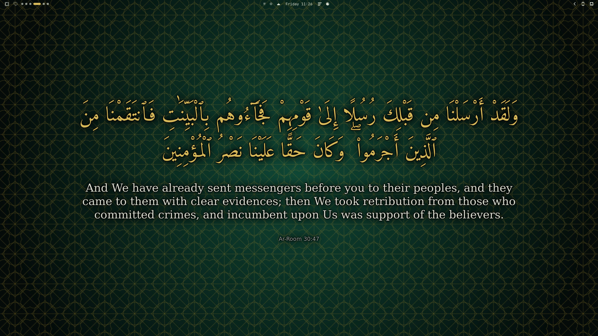
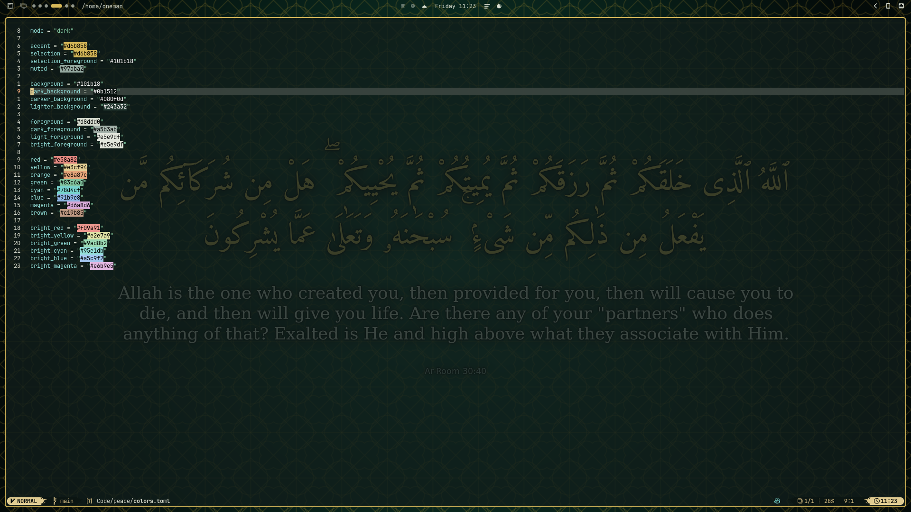
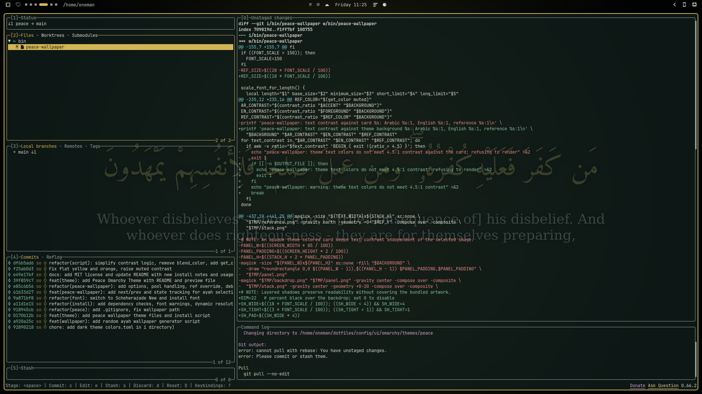

# Peace Omarchy Theme

This repository provides an Omarchy theme centered on Quran ayah wallpapers. It configures timed wallpaper rotation, theme actions, and static background choices; Omapeace renders the ayah wallpapers. Use `peace-theme` for this repository's commands. The plugin adds audio listening, playback controls, and a top-bar interface through the separate `peace` command.






## Backgrounds

Peace rotates the ayah wallpaper periodically while Peace is the active Omarchy theme: it runs one minute after login, then every three hours and one minute. Rendering and wallpaper changes use the Omapeace plugin's `peace` command; this repository only configures the timer and theme actions. The installer generates the first wallpaper immediately and gives the active copy a `temp_` filename. Each render needs internet access to AlQuran Cloud.

The Arabic Uthmani text is served by AlQuran Cloud as `quran-uthmani`; AlQuran Cloud says its text sources include [Tanzil](https://tanzil.net/) and [Quran Academy](https://quranacademy.io/). The English translation is Saheeh International (`en.sahih`), as identified in [AlQuran Cloud's API client documentation](https://alquran.cloud/api-clients).

The theme also includes these static backgrounds:

| Pattern | Glow | Minimal |
| --- | --- | --- |
|  |  |  |

## Wallpaper controls

Choose a random ayah, or move to the next or previous ayah from a terminal:

```bash
peace-theme random
peace-theme next
peace-theme prev
```

Use `peace-logs` to inspect wallpaper rotation, and `peace-enable` or `peace-disable` to control its timer. `peace-theme` is the dispatcher for this repository; `peace` belongs to Omapeace and performs rendering, wallpaper selection, listening, and playback controls.

Theme actions are also available as standalone commands: `peace-random`, `peace-next`, `peace-prev`, `peace-wallpaper`, `peace-init`, `peace-uninstall`, `peace-logs`, `peace-enable`, and `peace-disable`. Each standalone command has its own `--help` output.

To use `Super + Alt + P` and `Super + Alt + N` in Hyprland, add an optional user binding file at `~/.config/hypr/bindings/peace-wallpaper.lua`:

```lua
o.bind("SUPER + ALT + P", "Previous ayah", "peace-theme prev")
o.bind("SUPER + ALT + N", "Next ayah", "peace-theme next")
```

Omarchy loads Lua files from this user bindings directory. It removes Lua files from third-party theme installs for safety, so add these bindings to your own Hyprland config. The installer creates the initial ayah state, after which next and previous are available.

## Listening with Omapeace

This repository provides the Omarchy theme, timer, and `peace-theme` command grouping. Omapeace provides the shared `peace` command, which handles ayah rendering and random/next/previous wallpaper changes as well as audio playback, playback controls, the top-bar icon, and follow mode. Follow mode prepares and displays upcoming ayah wallpapers inside the plugin. The theme delegates wallpaper actions to that command instead of carrying a second renderer or playback implementation. Initialization installs and enables Omapeace and installs its `peace` command.

Play a surah, one ayah, or an ayah range in order:

```bash
peace listen 55
peace listen 55:5
peace listen 55:5-10
peace listen 55:5-
peace listen 55 --follow
peace listen
peace listen 55:1-20 --follow --buffer 6
peace listen 112 --reciter ar.husary
PEACE_RECITER=ar.alafasy peace listen 1
peace pause
peace stop
peace status
peace-theme wallpaper next
peace help
```

The plugin requires `mpv` and internet access to AlQuran Cloud. `--reciter ID` overrides `PEACE_RECITER` (default `ar.alafasy`). With `--follow`, audio starts while upcoming audio and wallpapers are cached for playback. `--buffer N`, `--lead N`, and `--jobs N` control preparation.

## Install

Install the theme and wallpaper rotation on a new Omarchy device with one command:

```bash
omarchy theme install https://github.com/sohanemon/omarchy-peace-theme.git && "$HOME/.config/omarchy/themes/peace/bin/peace-init"
```

Omarchy installs and activates the theme under `~/.config/omarchy/themes/peace`. `peace-init` checks for a working user systemd session, installs and enables Omapeace, runs the plugin's `peace install` command, links this theme's commands, and enables the wallpaper timer. The initial active wallpaper copy is named `temp_<timestamp>.png`; scheduled and manual wallpaper files are managed by Omapeace.

### Requirements

The theme installer requires a working `systemctl --user` session. Omapeace handles rendering dependencies and requires internet access to AlQuran Cloud; audio playback requires `mpv`.

Omapeace bundles its text shaping, fonts, and image rendering in its command, so this theme does not require ImageMagick, Pango, or system font packages for wallpaper generation.

To apply the theme again later, run:

```bash
omarchy theme set peace
```

## Uninstall

Switch to another installed theme before removing Peace, then run the master command:

```bash
peace stop
omarchy theme set "Tokyo Night"
peace-theme uninstall
```

`peace-theme uninstall` disables the timer, removes the installed theme commands and any legacy bundled font, then removes the theme through Omarchy. It leaves `~/.config/omarchy/backgrounds/peace/` intact, preserving personal backgrounds. Remove the Omapeace plugin separately with `omarchy plugin remove io.github.sohanemon.omapeace` if you no longer want its command or icon.

## License and text credits

This project's code is MIT licensed; see [LICENSE](LICENSE). The bundled Amiri font asset is separately licensed under the SIL Open Font License 1.1; its required notice is in [`fonts/OFL-Amiri.txt`](fonts/OFL-Amiri.txt). Quran text and translation credits are listed above.
